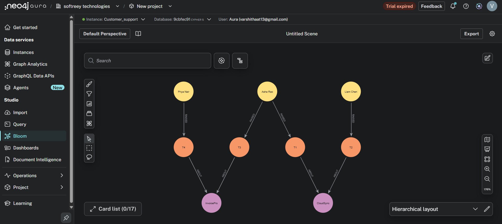

# Customer Support Ticket Analytics & Evaluation

A Python project that validates and analyzes support tickets, scores ticket summaries against a human-labeled benchmark, and loads ticket data into a Neo4j knowledge graph.

## Project layout

```text
.
├── data/
│   └── tickets_raw.json
├── part_a/
│   ├── models.py
│   ├── pipeline.py
│   ├── test_pipeline.py
│   └── output.json
└── part_b/
    ├── evaluation/
    │   ├── data/golden_set.json
    │   ├── manual.py
    │   ├── llm_judge.py
    │   ├── orchestrator.py
    │   ├── schemas.py
    │   ├── calibrate.py
    │   └── report.py
    └── knowledge_graph/
        ├── graph_builder.py
        ├── schema.cypher
        ├── ingest.cypher
        └── queries.cypher
```

## Requirements and setup

- Python 3.10 or later
- Neo4j only if you want to run the knowledge-graph builder
- Ollama only if you want to run the automated LLM judge

From the project root in PowerShell:

```powershell
python -m venv .venv
.\.venv\Scripts\Activate.ps1
python -m pip install -r requirements.txt
```

If you already have an active virtual environment, you can skip the first two commands.

## Part A: validate, clean, and analyze tickets

Run from the project root:

```powershell
python -m part_a.pipeline
```

The pipeline validates records against the Pydantic `Ticket` model, flags empty issue text, removes duplicate `ticket_id` values (keeping the first occurrence), calculates ticket counts by product and status, and averages valid resolution times. It writes the results to [`part_a/output.json`](./part_a/output.json).

Run the test suite with:

```powershell
python -m pytest -v
```

## Part B: evaluate ticket summaries

### Offline, human-labeled benchmark

The offline benchmark needs no model, API key, Ollama installation, or network access:

```powershell
python -c "from part_b.evaluation.orchestrator import run; run(use_llm=False)"
```

It prints the manual scorecard and trace. The benchmark labels are in [`golden_set.json`](./part_b/evaluation/data/golden_set.json). The score uses precision (35%), recall (40%), and specificity (25%); the normalized weighted total is between 0 and 1.

### Optional local LLM-as-judge with Ollama

The automated judge uses a local Ollama service; it does not send ticket summaries to a hosted LLM API. Install [Ollama for Windows](https://ollama.com/download/windows), reopen PowerShell, and download the default model:

```powershell
ollama pull qwen2.5:3b
```

Then run the orchestrator:

```powershell
python -m part_b.evaluation.orchestrator
```

The module entry point enables LLM scoring. It expects Ollama at `http://localhost:11434` and uses `qwen2.5:3b` by default. To use a different local host or model, set process environment variables before starting Python:

```powershell
$env:OLLAMA_HOST = "http://localhost:11434"
$env:OLLAMA_MODEL = "qwen2.5:3b"
python -m part_b.evaluation.orchestrator
```

The Ollama model download requires internet access; scoring requests are made to your local Ollama service.

## Part B: build the Neo4j knowledge graph

Create a `.env` file in the project root with your Neo4j instance’s Bolt URI and credentials:

```dotenv
NEO4J_URI=neo4j+s://your-instance-host
NEO4J_USER=your-username
NEO4J_PASSWORD=your-password
```

Run the builder from the project root:

```powershell
python -m part_b.knowledge_graph.graph_builder
```

The builder loads `.env`, validates and deduplicates the source tickets, creates uniqueness constraints, ingests the graph using `MERGE`, and queries customers with tickets about more than one product. Keep `.env` private; it is excluded by the repository’s `.gitignore`.

The graph model is:

```text
(:Customer)-[:RAISED]->(:Ticket)-[:ABOUT]->(:Product)
```

## Sample results

These are outputs from the project ticket data and golden-set benchmark.

### Data pipeline

The current [`output.json`](./part_a/output.json) reports:

| Metric | Result |
|---|---:|
| Raw ticket records | 5 |
| Duplicate records removed | 1 |
| Unique tickets retained | 4 |
| Empty issue fields flagged | T4 |
| Average resolution time | 13.5 hours |

Each product has one open and one resolved ticket.

### Manual summary benchmark

| Ticket | Product gate | Fact coverage | Weighted score | Finding |
|---|---|---:|---:|---|
| T1 | PASS | 0.667 | 0.840 | Omits the password-reset trigger |
| T2 | FAIL | 0.500 | 0.560 | Does not name CloudSync |
| T3 | PASS | 1.000 | 0.900 | Includes the unsupported claim “bug” |

These are deterministic scores from the human labels in the golden set, not scores returned by an LLM.

### Knowledge graph outcome

The ingested data contains three customers, four unique tickets, and two products. Its relationships and the multi-product customer result are shown below:



The multi-product query returns:

```json
{
  "customer": "Asha Rao",
  "products": ["CloudSync", "InvoicePro"],
  "product_count": 2
}
```

## Implementation notes

- Part A uses Pydantic validation and keeps flagged records for audit rather than silently dropping them.
- Deduplication preserves the first ticket with each ID.
- Negative resolution-time intervals are excluded from the average.
- The manual benchmark is the deterministic baseline; Ollama scoring is optional and requires a running local service.
- The Cypher schema, ingestion, and query examples are also available as separate files under [`part_b/knowledge_graph/`](./part_b/knowledge_graph/).
